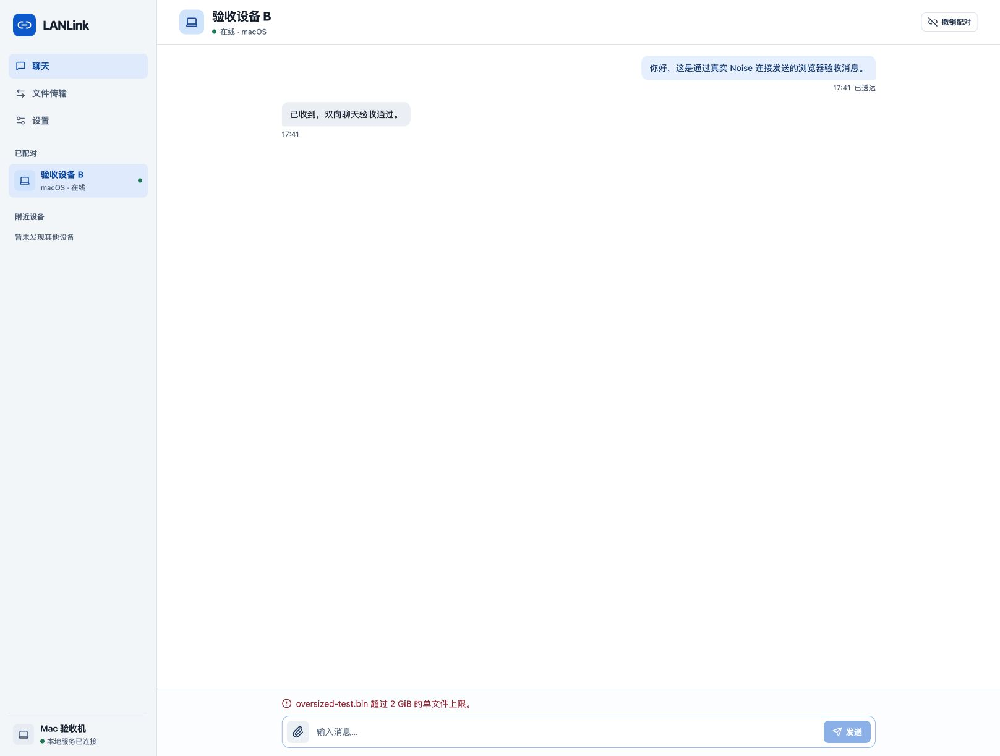
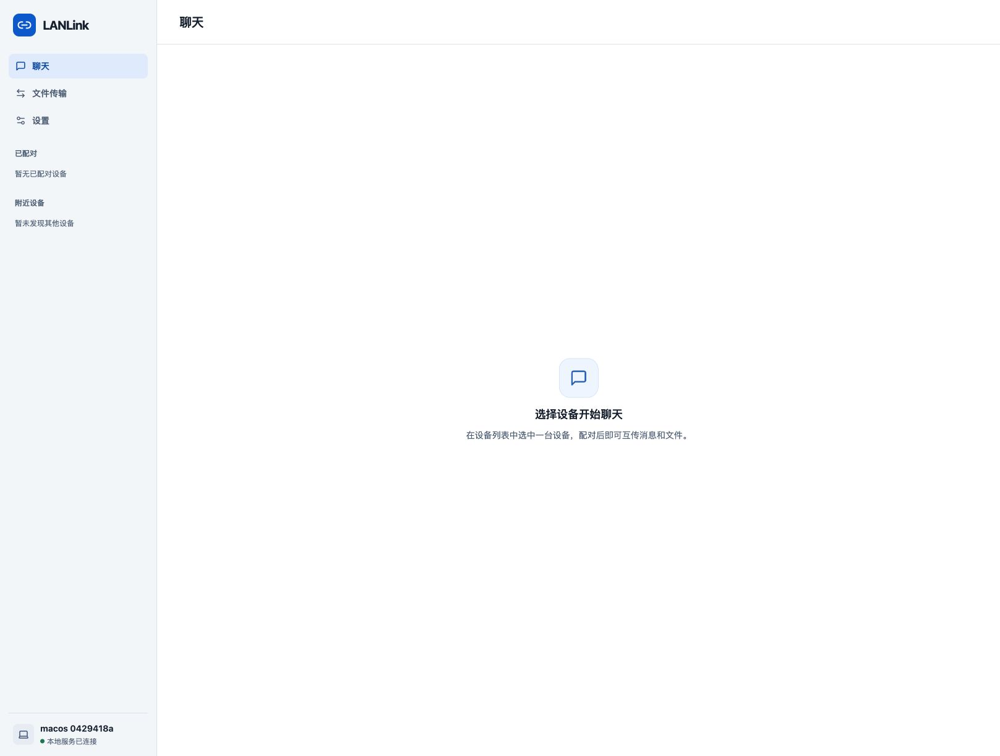

# v0.1.0 验收记录

Mac 与 Windows 已完成原生安装、双确认配对、双向消息、双向 10 MiB 与 1 GiB 文件、4 MiB 断点恢复、身份与历史保留、撤销授权及重新配对。发现稳定性修复已在两端超过四分钟的采样中通过，Windows 强杀后的离线更新及自动恢复也已验证。当前可使用开发预览，未发布正式完成声明。

最新结果与安装包哈希见[文件传输修复及最终候选报告](review-fixes.md)。[发现修复阶段报告](physical-final.md)和[初次双机基线](physical-baseline.md)分别保留此前候选的证据。T15 已通过单 Mac 上真实 mDNS、TCP、Noise 和 SQLite 的受控端点换址；实际物理网卡换址及网络切换不在已测范围。

## 当前候选

运行代码为 `c076be2`。`8fe8bc8` 追加可复现的文件失败回归脚本，`93a565d` 仅在两端安装包中加入 MIT 许可证。重打包后，Agent、网页及启动脚本与对应平台的实测安装内容逐字节一致。macOS 新增许可证后重新生成应用签名。

Mac 和 Windows 原生运行的 34 项 Rust 测试、24 项 Web 测试、严格 Clippy、格式检查、ESLint 与生产构建通过。最终候选在真实双机上复验双向超限拒收、拒收后的消息回执、多文件入队、双向 1 GiB 及双向强停恢复。接收端分别对完整文件独立计算 SHA-256。日志、截图、测试失败及观察限制均保留在[当前报告](review-fixes.md)。

## 早期 Mac 本机验证的环境与候选身份

2026-11-17 在 Apple Silicon macOS 27.0 上执行。Rust 1.100.0，Node.js 24.22.2。最初的大文件发布构建来自 `4c6aeb7efc66c38dc853e08f24ee998103ad626c`，二进制 SHA-256 为 `f76003b4a24a6dbf61d19531686b6d41b5d921291621933502fe67cd7fef3bf9`。

本节早期安装包内 Agent 的 SHA-256 为 `383d4358389f08a6a4b55386c4b58db0510410528489f32d70db4cc3b59106ba`，对应源码提交 `a15025c0407bd668fa3b1378393964f1984645b0`，含上述提交加独立复核过的 crates 差异，差异 SHA-256 为 `bd73f8dd9e7d6ed3af17530b58794e9f38b33b500994575f6aeb8cb0ad893e4b`。[最终完整集成日志](evidence/mac-release-final.log)在该打包二进制上通过全部选定检查。

[Rust 27 项测试](evidence/rust-tests.log)、[严格 Clippy](evidence/clippy.log)和 `cargo fmt --all -- --check` 均通过。

[二进制身份与命令](evidence/artifact-binding.txt)、[直接记录产物哈希的再次完整验证](evidence/mac-release-hash-bound.log)、[原生安装生命周期命令输出](evidence/mac-native.log)及[前端测试输出](evidence/web-tests.log)分别保留对应证据。公开日志中的用户名路径和私网 IP 已脱敏，原始日志保留在开发机；临时设备 ID 来自隔离测试身份。

前端生产构建、ESLint 和 13 项 Vitest 测试通过。升级测试依赖后 `npm audit` 报告 0 项漏洞。以上是工具运行结果，不构成无安全缺陷保证。

## 测试结果

| 编号 | 内容               | Mac 本机双 Agent                               | Mac 与 Windows 实机                          |
| ---- | ------------------ | ---------------------------------------------- | -------------------------------------------- |
| T01  | Mac 启动 Agent     | 通过                                           | Mac 已验证                                   |
| T02  | Windows 启动 Agent | 不适用                                         | Windows 原生安装通过                         |
| T03  | 自动发现           | 真实 mDNS 通过                                 | 初次发现与修复后的两端持续采样通过           |
| T04  | 离线状态更新       | 正常停止与重启通过；异常断电广播过期未独立计时 | 通过；Windows 强杀后 97.282 秒更新离线       |
| T05  | 上线自动恢复       | 通过                                           | 双端重启及最终候选硬停止后自动恢复           |
| T06  | 未配对发送拒绝     | 通过                                           | 未配对与单端确认均拒绝                       |
| T07  | 双向文本通信       | API 与浏览器均通过                             | 双向通过；相同 ID 各一条                     |
| T08  | 历史消息恢复       | 通过                                           | 双端重启后通过                               |
| T09  | 10 MiB 文件        | 磁盘与 HTTP 下载哈希均一致                     | 双向通过；实际落盘哈希一致                   |
| T10  | 双向 1 GiB 文件    | 通过                                           | 双向通过；实际落盘哈希一致                   |
| T11  | 传输中断恢复       | 1 GiB 自动续传通过，首发偏移日志吻合           | 两个方向均通过；反向首发偏移与停机磁盘值一致 |
| T12  | SHA-256 一致       | 通过                                           | 接收端逐文件另算哈希一致                     |
| T13  | 身份与数据保留     | 通过                                           | 双端重启与 Windows 卸载重装均保留            |
| T14  | 撤销授权           | 拒绝本地发送，观察 5 秒无新接收                | 通过；重启前后均拒绝旧信任投递               |
| T15  | IP 改变重新发现    | 真实端点迁移、自动重连及唯一 ACK 通过          | 未改变物理网卡地址                           |

Mac 本机双进程集成测试不代替物理双机、防火墙及跨平台文件系统测试。内存、启动、发现延迟和 ACK 性能目标尚未测量。

## 可复现集成验证

```sh
cargo build --release --locked -p lanlink-agent
npm run build
python3 scripts/smoke.py --agent target/release/lanlink-agent --web-dir apps/web/dist --file-mib 1024 --resume-mib 1024 --file-timeout 300
```

脚本使用隔离的数据目录、随机端口和实际 Agent 进程。没有模拟设备或传输。它在结束时停止自己启动的进程，保留目录与日志供检查。日志中的 mDNS 地址包含本机 LAN 地址和回环地址，不能据此声称跨物理设备传输。

[初次 10 MiB 与 64 MiB 验证](evidence/mac-smoke-initial.log)覆盖持久化、授权拒绝、重试、取消和撤销。[发布构建 1 GiB 验证](evidence/mac-release-1g-initial.log)增加反向传输和真实续传起点检查。双向完整文件的 SHA-256 为 `dd921821c346ba3ca8bb0e60659a0c60dd45bd4d0fa9a875e96d032707f824a0`。中断测试从持久化的 2 MiB 偏移恢复，最终哈希为 `7e37e2e55ea3675ea0fd50ba2627f9bb568b2e11257937c9064e26f4ea147c0d`。

## 浏览器证据

### 扫码传文件

新增扫码入口通过以下本机验证。

- 前端 lint、35 项单元测试及生产构建通过。Rust workspace 的 42 项测试、格式检查和 Clippy 通过。
- `scripts/mobile-smoke.py` 使用实际局域网 IPv4 和隔离 Agent，验证一次性邀请、确认前拒绝传输、确认码、双向文件字节一致、超限拒绝、中断上传清理，以及撤销后关闭监听并保留接收文件。
- Chrome 完成显示二维码解码、电脑确认、两端原生附件下载及会话结束。WebKit 26 完成电脑端和 iPhone 视口下的相同收发流程，并检查 390px 和 820px 页面没有横向溢出。
- `scripts/mobile-remember-smoke.py` 验证首次记住浏览器、跨监听端口自动连接、Agent 重启后自动连接、访客模式，以及忘记浏览器后断开连接并在重启后保持撤销。Chrome 与 WebKit 26 页面完成默认记住、再次扫码免确认、忘记后重新确认和访客模式流程。
- 现有双 Agent 集成脚本完成配对、双向消息、双向 1 MiB 文件、4 MiB 文件中断续传及撤销回归。

自动验证运行在同一台 Mac 上。用户已确认手机扫码连接和文件传输成功。

2026-11-18，Mac 安装官网发布的 `v0.2.0-preview.1` 并重启后，用户用升级前已记住的同一个手机浏览器扫描新二维码。电脑端直接显示「设备已连接」，无需再次输入 6 位确认码。用户确认真机直连通过。具体手机机型和浏览器版本未记录。

其他移动平台、系统文件保存，以及 Windows 原生防火墙和接收文件行为仍待验证。扫码会话使用局域网 HTTP，界面提示传输未加密，仅在可信 Wi-Fi 使用。

### 桌面设备传输

真实双 Agent 网页完成双方核对安全码并分别批准、双向聊天、选择文件、接收端接受、传输完成、设备改名、390px 窄屏导航。控制台未见警告或错误。上传后进入传输记录的改动已在浏览器验证，混合超限文件批次保留聊天页错误提示。




## 首次失败与修复

最初 10 MiB 上传失败，原因是读取下一个 multipart 字段前仍持有前一个字段。释放该字段后重新执行全部选定流程通过。早期 debug 1 GiB 测试被主动停止，因未明确启用续传偏移日志且不代表发行构建；未将该轮计为通过。

[快速重启发现失败记录](evidence/mac-smoke-mdns-failure.log)保留了后续失败。调试日志确认旧进程 goodbye 被缓存为 1 秒 TTL，新进程在其到期前发布相同记录；锁定的 mdns-sd 0.21.7 只刷新 TTL，未重新发出 ServiceResolved。广播实例名与主机名改为进程级随机后缀，持久设备 ID 不变。另一次[等待条件失败](evidence/mac-smoke-discovery-wait-failure.log)来自把已有加密连接的在线状态当作 mDNS 地址已齐；脚本已改为等待实际地址与端口，保留原字段断言。

独立审查发现消息转义后的帧上限、异常时间、配对超时清理、发现容量、Unicode 广播名、握手名额、配额回收和损坏发送快照问题。以上问题与后续发现的上传名额竞争、发送源丢失配额及旧配对确认竞争均已修复，最终独立复核未发现剩余 P1/P2。记录见[独立审查](evidence/review.md)。脚本审查还修正了停止进程时吞掉枚举失败，以及 Windows 启动日志与卸载说明。

## 早期 Mac 安装候选实测

此前最终候选轮验证了快速重启后的 mDNS 发现、明确离线与重新上线、双向消息、双方重启后历史、离线重投、双向 1 GiB 文件、取消、拒收和撤销。完整文件哈希为 `7ff84aa8ddbc0d6c8e92d97bd90129a50d09deaf59f02626d5e9981ad76ee09b`。另一份 1 GiB 文件从日志证明的 3 MiB 持久偏移自动续传，完成哈希为 `05243dd09dc259e1f1c70ea0ff6027c852126edfe226169dfe18da2905ab90ca`。

测试还在已隔离的发送快照中修改一个字节。接收端校验失败，完整目标未发布，随后新聊天仍成功。未跳过校验或放宽断言。

macOS PKG 已展开并验证内含应用的 ad-hoc 签名。应用已复制安装到 `/Applications/LANLink.app`，真实启动后健康 API 返回成功，网页连接成功。可选登录启动经过 `launchctl bootstrap` 和健康检查；卸载辅助脚本成功关闭登录启动并停止 Agent，保留 SQLite 与文件目录。测试后恢复 Agent，登录启动保持关闭，应用保留供使用。没有执行管理员 PKG 安装或将应用移入废纸篓。[打包日志](evidence/mac-package.log)保留了工具输出的 `write: Permission denied` 警告；打包退出码为 0，随后对展开的应用执行 `codesign --verify --deep --strict` 通过。

| 产物              | SHA-256                                                            |
| ----------------- | ------------------------------------------------------------------ |
| Apple Silicon PKG | `c5f3e161a8ec6439b40a0de043b7bba705ffa79e67f9ea7a08ba7185656693e3` |
| Apple Silicon ZIP | `4957fb5324786c115f495019e5ece8eec0e63ddf0880f46a7d11f80f4e0508da` |



## 当前交付范围

最新源码、测试及证据在 [PR #1](https://github.com/JackEngineer/LanLink/pull/1) 中，PR 未合并。Windows x64、Apple Silicon 和 Intel Mac 的构建、单元测试与打包结果见[当前候选报告](review-fixes.md)；物理电脑验收覆盖 Apple Silicon Mac 和 Windows x64。实际 DHCP 或网卡换址、物理 Intel Mac、OS 注销重登录及性能指标不在已测范围。可选登录项的创建、禁用、后台启动和卸载均有原生执行证据。

macOS 包采用 ad-hoc 签名，未提供 Developer ID 签名或 Apple 公证；Windows 开发脚本未签名。目前交付开发预览包，不发布 v0.1.0 正式完成声明。
