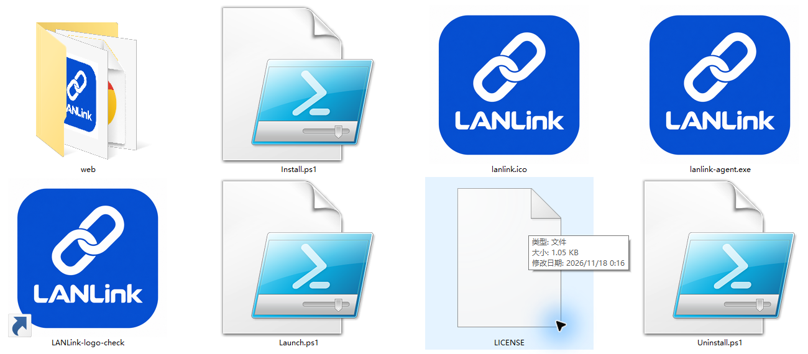

# LANLink 图标打包验证

原生验收使用 `3d8f8f6` 加本次 Logo 改动构建的 0.1.0 候选包。下列 SHA-256 对应当时的实际产物。

| 平台 | 结果 |
| --- | --- |
| Apple Silicon | 生成 PKG 和 ZIP，校验包内 ICNS、应用签名及网页资源，在 Finder 的「显示简介」看到新图标。 |
| Intel Mac | 交叉构建 PKG 和 ZIP，校验应用签名及包内 ICNS。Intel 真机运行未验收。 |
| Windows x64 | 原生构建 ZIP，EXE 的 7 个嵌入图像帧与源 ICO 一致。资源管理器显示 EXE 和测试快捷方式的新图标。 |

| 原生验证产物 | SHA-256 |
| --- | --- |
| Apple Silicon PKG | `c6f24bbca19acdcff45ee54aef45f537b4af7e2548fcc453ef2716d25c4559f3` |
| Intel Mac PKG | `59b1b6eb518c8b90ceec980465b5bf3995a999377e0b5631e29e1740029ca56d` |
| Windows x64 ZIP | `6b5be9f6a28563927471085215271d2214450fb9a78ab0f69f590d35678444fb` |
| Windows EXE | `378c68775f686b0b7463c3b8afc2b506114a43b4c6fcc2bfc20348be42ae6ce2` |

macOS 系统从 Apple Silicon 应用包渲染的图标。

Windows 资源管理器的图标视图，保留 EXE、源 ICO 与测试快捷方式的区域。

