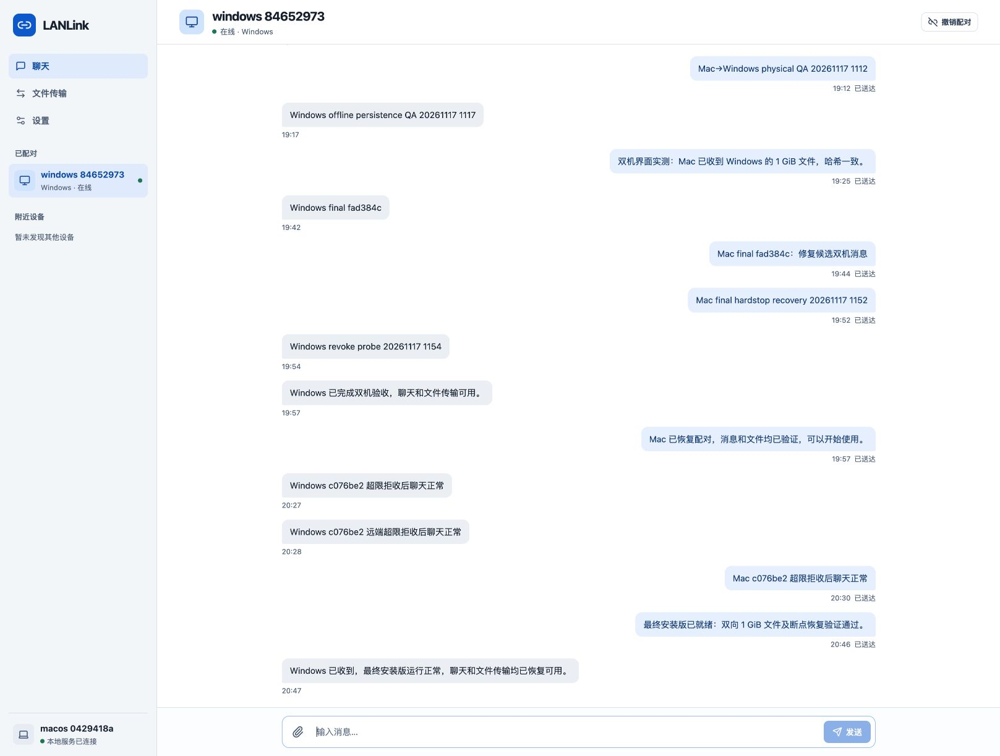
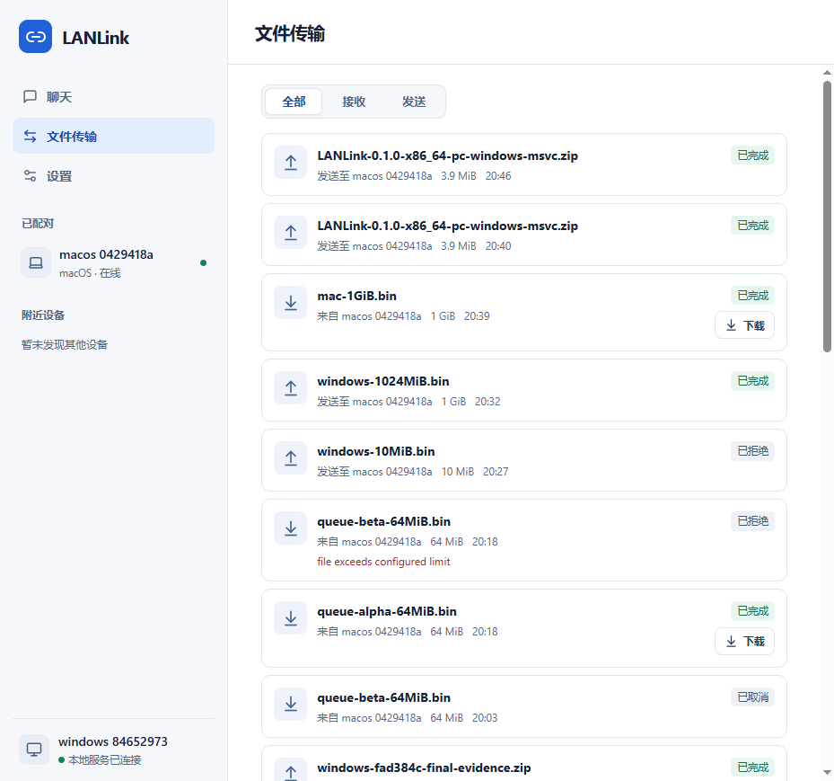

# 文件传输审查修复与双机复验

2026 年 11 月 17 日，Apple Silicon Mac 与 Windows x64 使用原生安装的 LANLink 验证了多文件上传、超限拒收、双向中文聊天和双向 1 GiB 文件续传。两端强制结束接收 Agent 后分别重启，原发送进程自动完成同一任务，接收端另算的落盘 SHA-256 均匹配。文件失败和授权检查也在安装版 Agent 上通过。

实机运行版本为 `c076be2e17670a27791d00eb5b46ff90322dd551`。后续 `8fe8bc8` 增加单机回归脚本 `scripts/file-failures.py`，`93a565d4693f5574da3493320068a890ec611138` 让原生打包脚本复制 MIT 许可证。当前预览包来自 `93a565d`，运行文件与已实测的同平台版本一致。此前候选的发现、配对、撤销及重启记录见[双机发现与生命周期验收](physical-final.md)。

## 三项 P2 审查修复

| 审查意见                                                                                        | 修复后的行为                                                                                                                                                                                          |
| ----------------------------------------------------------------------------------------------- | ----------------------------------------------------------------------------------------------------------------------------------------------------------------------------------------------------- |
| [多选上传互相抢占](https://github.com/JackEngineer/LanLink/pull/1#discussion_r4598386620)       | 多选或拖入的合规文件按顺序上传，排队中与上传中的文件都可单独取消。只有 Agent 返回 HTTP 400 和 `another upload is in progress` 才重试，最多四次，累计等待 1.5 秒。取消会终止令牌请求、上传或重试等待。 |
| [超限文件破坏会话](https://github.com/JackEngineer/LanLink/pull/1#discussion_r4598386648)       | 接收、续传和校验时使用当前大小上限。超限提议在校验传输身份后拒绝，同一连接仍可聊天或传输合规文件。已完整发布且哈希匹配的文件保留，清理失败时保留占用记录。                                            |
| [发送源不可用后无法取消](https://github.com/JackEngineer/LanLink/pull/1#discussion_r4599005446) | 快照损坏的发送任务显示失败，用户可主动取消并回收空间，包括已解除配对的情况。Agent 在同一对端的操作锁内先删除快照，再记录取消。磁盘清理失败时保留配额。                                                |

三条意见均已回复并标记解决。本地独立代码复审通过，未发现未解决的 P1 或 P2。Git 对比确认最终候选的前端源码和依赖锁与审查版本 `5ab3b5d19ddb22d3285007d569668ee7876aeed3` 一致，后端 Rust 源码和依赖锁与审查版本 `89ba9ff04bf721c749a4ae88502754324c8a7618` 一致。云端 Codex 自动复审因额度耗尽未完成。[云端复审记录](https://github.com/JackEngineer/LanLink/pull/1#issuecomment-6947754495)

## 多文件上传和超限拒收

- 在 Mac 一次选择两份 64 MiB 文件。旧版一份报忙，修复版两份依次进入「等待接收」，Windows 均收到提议。Windows 接收 alpha 并独立校验落盘 SHA-256 为 `281e519df3077b557c6b03f5da83c4e8d397219259615dd7c3308f89cae8f2a6`。随后把 Windows 的接收上限降至 1 MiB，仍待接收的 beta 被拒绝，未生成完整文件，已完成的 alpha 保持原哈希。[旧版界面](evidence/review-fixes/multi-upload-before.jpg) · [修复版界面](evidence/review-fixes/multi-upload-after.jpg) · [Mac 提议](evidence/review-fixes/mac-multi-upload.json) · [Windows 收到的提议](evidence/review-fixes/windows/runtime/multi-offer-before.json) · [alpha 落盘](evidence/review-fixes/windows/runtime/alpha-disk-verified.json) · [拒收后落盘与聊天检查](evidence/review-fixes/windows/runtime/oversize-preservation-and-chat.json)
- 两个方向各用新 10 MiB 文件验证远端拒收。发送端上限 2 GiB，接收端上限 1 MiB。发送端记录为 `rejected` 且偏移为 0，接收端均无任务记录、部分文件或完整文件。拒收后的中文消息获得回执。第一次 Windows 探测时本地也设为 1 MiB，上传提前中止且未产生传输 ID，远端结果来自调整上限后的重跑。[Windows 发送记录](evidence/review-fixes/windows/runtime/remote-oversize-results.json) · [Mac 接收检查](evidence/review-fixes/mac-oversize-received.json) · [Mac 发送记录](evidence/review-fixes/mac-oversize-sent.json) · [Windows 接收检查](evidence/review-fixes/windows/runtime/reverse-oversize-verified.json) · [第一次上传错误](evidence/review-fixes/windows/runtime/oversize-upload-error.txt)
- Mac 上用两个隔离的安装版 Agent 复跑损坏快照场景。发送失败后，接收端转为已取消，重试及解除配对后的聊天被拒绝，主动取消移除残留的 9 字节快照。该轮也核对了超限拒收、双向聊天回执及合规文件的落盘哈希。[安装版回归日志](evidence/review-fixes/mac-installed-file-failures.log)

Windows 的一次日志筛选因空管线未创建输出文件，随后读取失败。改用只读计数后匹配项为 0，日志结果无法单独证明发送循环是否开始。[采集记录](evidence/review-fixes/windows/runtime/oversize-log-check.json)

## 两端实机强制停止和续传

| 方向           | 传输 ID                                | 接收端持久化偏移 | 接收端落盘 SHA-256                                                 |
| -------------- | -------------------------------------- | ---------------: | ------------------------------------------------------------------ |
| Windows 到 Mac | `bcbed60c-1ac8-42fb-b5de-2413377f6ee2` |   4,194,304 字节 | `9674bda70c01181b475879a0bd0ea2847d55335fb592fff65f423f4e36d5d859` |
| Mac 到 Windows | `5298ba91-b7f8-4bf8-a960-5616578afe56` | 341,835,776 字节 | `9abc035488a85bdd2237e51ed32481c8bba1a326e2730145d1ac1971d52ff19e` |

**Windows 到 Mac。** 强制结束 Mac 接收进程后，SQLite 偏移和部分文件均为 4 MiB。Windows 发送进程 PID `30696` 保持不变，在 Mac 重启后同一传输自动完成。Windows 本轮使用 `RUST_LOG=warn`，未记录恢复时的发送流起始偏移。[Mac 停机检查](evidence/review-fixes/mac-interruption.json) · [Windows 暂停](evidence/review-fixes/windows/runtime/resume-paused.json) · [恢复进度](evidence/review-fixes/windows/runtime/resume-progress.jsonl) · [Mac 落盘校验](evidence/review-fixes/mac-resumed-received.json) · [Windows 日志限制](evidence/review-fixes/windows/runtime/resume-logging-limitation.txt)

**Mac 到 Windows。** 强制结束 Windows 接收进程 PID `30696` 后，SQLite 偏移和部分文件均为 341,835,776 字节，完整文件尚未发布。Mac 发送进程 PID `82689` 保持不变。Windows 重启为 PID `31824` 后，Mac 记录的恢复发送流的起始偏移与 Windows 停机持久化值一致。双方 API 都记录 1,073,741,824 字节已完成，Windows 独立校验了落盘文件。[Windows 进程退出](evidence/review-fixes/windows/runtime/reverse-hard-stop.json) · [停机磁盘检查](evidence/review-fixes/windows/runtime/reverse-stop-disk.json) · [重启与恢复](evidence/review-fixes/windows/runtime/reverse-restarted.json) · [Mac 发送起始日志](evidence/review-fixes/mac-reverse-resume.log) · [Mac 完成记录](evidence/review-fixes/mac-reverse-completed.json) · [Windows 完成记录](evidence/review-fixes/windows/runtime/reverse-final.json) · [Windows 落盘校验](evidence/review-fixes/windows/runtime/reverse-disk-verified.json)

反向传输的一次接受请求返回 `only incoming offers can be accepted`。紧随其后的查询已显示任务处于 `transferring`，与已经接受后再请求接受的状态冲突一致。现场未保存 HTTP 状态码，也未确定首次接受的来源。后续在同一任务上执行了上述强停和续传。[原调用、错误及后续状态](evidence/review-fixes/windows/runtime/reverse-accept-failure-analysis.md)

## 原生构建和安装包

- Apple Silicon Mac 与 Windows x64 均通过 34 项 Rust 测试、24 项 Web 测试、Rust 格式检查、严格 Clippy、前端 lint 和原生构建。两项新增 Rust 用例在修复前分别复现会话断开和失败任务无法取消。[Mac Rust 修复前](evidence/review-fixes/red-rust.log) · [Mac Rust 修复后](evidence/review-fixes/test-workspace.log) · [Mac Web](evidence/review-fixes/web-tests.log) · [Mac Clippy](evidence/review-fixes/clippy.log) · [Windows Rust](evidence/review-fixes/windows/checks/cargo-test.log) · [Windows Web](evidence/review-fixes/windows/checks/npm-test.log) · [Windows 检查记录](evidence/review-fixes/windows/checks/checks-passed.json)
- GitHub Actions 在 `c076be2` 上完成 Windows x64、Apple Silicon Mac、Intel Mac 三组检查及打包。加入许可证后的 `93a565d` 也通过全部三组检查和打包。[最终 CI 状态](evidence/review-fixes/ci-93a565d.json)记录了源码提交及任务结果。[c076be2 构建 44081412256](https://github.com/JackEngineer/LanLink/actions/runs/44081412256) · [93a565d 构建 44085576200](https://github.com/JackEngineer/LanLink/actions/runs/44085576200)

三平台 CI 对应 `93a565d`。随后的验收文档提交不修改应用、依赖、测试或打包源码，不重复运行构建矩阵。

| 当前开发预览产物                                             | SHA-256                                                            |
| ------------------------------------------------------------ | ------------------------------------------------------------------ |
| macOS Apple Silicon `LANLink-0.1.0-aarch64-apple-darwin.pkg` | `ef48e2616c848e1badc6649a4c27970b9ae3f1d4d996ce8a31c281a415074987` |
| macOS Apple Silicon `LANLink-0.1.0-aarch64-apple-darwin.zip` | `bd20894b7beb4dbfeed1f8fc7cd5047f06ed0add1ff734aaed725dae60117731` |
| Windows x64 `LANLink-0.1.0-x86_64-pc-windows-msvc.zip`       | `308ba729fd73a45594b8f52d6ba32b028942b15d839470d31a2dc7a3e1d22f55` |

Intel Mac 的 CI ZIP SHA-256 为 `1f6929b13e5d30d81bdffe4a42f21dcae9173e29aa4dcab97a3df2f4d986cbe7`。归档已下载并核对 GitHub 外层产物哈希和包内许可证，未在物理 Intel Mac 上运行。[Intel 产物核对](evidence/review-fixes/intel-ci-package.json)

**Mac。** 加入许可证并重新签署外层应用后，九个运行文件与原实测安装逐字节一致。构建目录、当前 PKG 展开及最终安装应用的 14 个文件逐字节一致。打包日志记录四条 `write: Permission denied`，命令仍以 0 退出，产出 PKG 和 ZIP。覆盖安装后 Agent 通过健康检查，设备身份、配对、原设置和 21 条传输记录保留。已安装 Agent SHA-256 为 `e67309b97229cf27a2b78b5cbd63b19763c841b35ab6fea2d089b0faa6c76776`。[打包日志](evidence/review-fixes/mac-license-package.log) · [文件核对](evidence/review-fixes/mac-license-payload.json) · [覆盖安装检查](evidence/review-fixes/mac-final-install.json) · [覆盖安装后的配对界面](evidence/review-fixes/mac-final-chat.jpg)

**Windows。** 运行测试前的覆盖安装保留了设备身份、配对、原有 10 条消息和 18 条传输。含许可证的当前 ZIP 中，EXE、三个 Web 文件和三个安装脚本共七个运行文件与那次实测包及现有安装逐字节一致。Windows 只向现有安装目录补入许可证，Agent 未重启。现有安装保留一个旧版未引用的 JS 文件，当前包不含该文件。当前包的 JS 和 CSS 与 Mac 包逐字节一致，HTML 有 CRLF 和一行额外空白的差异，脚本和样式表引用一致。已安装 EXE SHA-256 为 `08aeb1733f97acea4ddac9529ab29f968731eb811efc5dbfd27b30e0d4ddfa71`。[覆盖安装检查](evidence/review-fixes/windows/runtime/installed-verified.json) · [旧实测包校验](evidence/review-fixes/windows-native-original.json) · [当前包校验](evidence/review-fixes/windows-native-license-package.json) · [已安装文件对比](evidence/review-fixes/windows/package/byte-comparison.json)

两端 Agent 继续在后台运行并保持配对，单文件上限均恢复至 2 GiB，登录启动关闭。最后两条双向中文消息均已送达。[Windows 最终状态](evidence/review-fixes/windows/runtime/final-state.json) · [Windows 消息记录](evidence/review-fixes/windows/runtime/final-messages.json) · [Mac 传输界面](evidence/review-fixes/mac-final-transfers.jpg) · [Windows 聊天界面](evidence/review-fixes/windows/runtime/final-chat.png)





macOS 应用使用 ad-hoc 签名，Developer ID 签名和 Apple 公证未执行。Windows 预览包未正式签名。Intel Mac 仅通过 CI，物理 DHCP 换址、真实注销重登录和性能基准仍未测量。

Windows 原始验收归档经 LANLink 传到 Mac，SHA-256 为 `73978e56ab1658fe5247fdc5eadb9af7bde7728fee96c312c1d8776e625e4116`。公开证据只使用测试数据。[Windows 归档核对与脱敏说明](evidence/review-fixes/windows/README.md)

同机双 Agent 的文件失败检查可用目标平台已安装或自行构建的 Agent 复跑。以下命令使用当前 Mac 的安装路径。

```sh
python3 scripts/file-failures.py --agent /Applications/LANLink.app/Contents/MacOS/lanlink-agent
```
